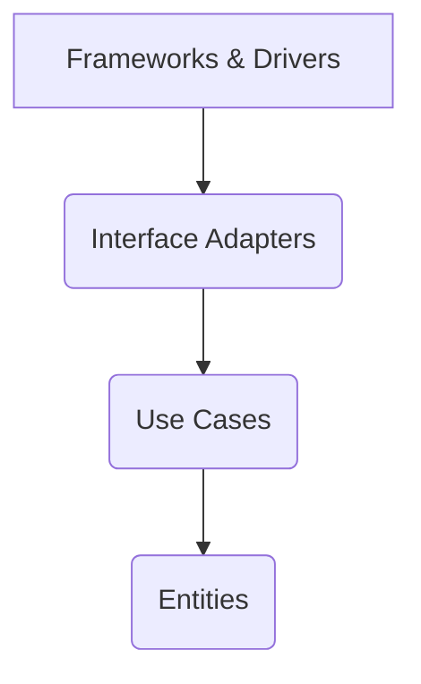

# Gabarito da Atividade Prática: Desenhando a Arquitetura de um Sistema de E-commerce

## Introdução

Este gabarito apresenta uma proposta de solução para a atividade prática, demonstrando a aplicação dos conceitos de Arquitetura Limpa e os diferentes estilos arquiteturais (Monolito, SOA, Microsserviços) no contexto de um sistema de e-commerce. As respostas são sugestões e podem haver outras abordagens válidas.

## 1. Análise Inicial e Arquitetura Limpa

### Casos de Uso Principais

Para o sistema de e-commerce, podemos identificar os seguintes casos de uso principais:

*   **Usuário:**
    *   `Navegar Produtos`
    *   `Visualizar Detalhes do Produto`
    *   `Adicionar Produto ao Carrinho`
    *   `Remover Produto do Carrinho`
    *   `Atualizar Quantidade no Carrinho`
    *   `Realizar Checkout`
    *   `Realizar Pagamento`
    *   `Acompanhar Pedido`
    *   `Registrar Usuário`
    *   `Fazer Login`
    *   `Atualizar Perfil`

*   **Administrador:**
    *   `Gerenciar Produtos` (Adicionar, Editar, Remover)
    *   `Gerenciar Usuários` (Visualizar, Bloquear, Desbloquear)
    *   `Gerenciar Pedidos` (Visualizar, Atualizar Status)
    *   `Gerenciar Categorias`

### Aplicação da Arquitetura Limpa: Caso de Uso `Realizar Pedido`

Vamos detalhar a aplicação da Arquitetura Limpa para o caso de uso `Realizar Pedido`. Este caso de uso envolve a finalização de uma compra, incluindo a validação do carrinho, cálculo de totais, processamento do pagamento e registro do pedido.

#### Camadas da Arquitetura Limpa

1.  **Entidades (Entities):**
    *   Representam as regras de negócio mais gerais e estáveis. São objetos puros de domínio, independentes de qualquer framework ou banco de dados.
    *   **Exemplos:** `Pedido`, `ItemPedido`, `Produto`, `Usuario`, `Carrinho`, `Pagamento`.
    *   **Regras de Negócio:** Um `Pedido` deve ter um `Usuario` associado, `ItensPedido` válidos (com `Produto` e `Quantidade`), e um `Status` (e.g., `Pendente`, `Processando`, `Concluído`, `Cancelado`). O cálculo do total do pedido é uma regra de negócio que reside aqui.

2.  **Casos de Uso (Use Cases / Interactors):**
    *   Contêm as regras de negócio específicas da aplicação. Orquestram o fluxo de dados para e das Entidades, e direcionam as Entidades para atingir os objetivos do caso de uso.
    *   **Exemplo:** `RealizarPedidoUseCase`.
    *   **Responsabilidades:**
        *   Receber os dados de entrada (e.g., ID do usuário, itens do carrinho).
        *   Validar o carrinho e a disponibilidade dos produtos.
        *   Interagir com `Gateways` (interfaces) para persistir o `Pedido` e atualizar o estoque.
        *   Interagir com um `Gateway de Pagamento` para processar a transação.
        *   Notificar o usuário ou outros sistemas sobre o novo pedido.
        *   Aplicar regras de negócio como cálculo de frete ou descontos.

3.  **Adaptadores de Interface (Interface Adapters):**
    *   Convertem dados do formato mais conveniente para os Casos de Uso e Entidades para o formato mais conveniente para os Frameworks e Drivers externos (e vice-versa).
    *   **Exemplos:**
        *   **Controladores/Presenters (para UI/Web):** `PedidoController` (recebe requisições HTTP, chama `RealizarPedidoUseCase`, formata a resposta).
        *   **Gateways de Persistência (para Banco de Dados):** `PedidoRepositoryImpl` (implementa a interface `IPedidoRepository`, traduz objetos de domínio para entidades de banco de dados e vice-versa, usa um ORM ou JDBC).
        *   **Gateways de Pagamento (para APIs externas):** `PaymentGatewayAdapter` (implementa a interface `IPaymentGateway`, traduz chamadas para a API externa de pagamento).

4.  **Frameworks e Drivers (Frameworks & Drivers):**
    *   Camada mais externa, composta por detalhes de implementação como bancos de dados, frameworks web, UIs, etc. São os componentes que a aplicação 

consome, mas não depende deles para suas regras de negócio.
    *   **Exemplos:** Spring Boot, Django, Express.js, PostgreSQL, MySQL, Stripe API, PayPal API.

#### Fluxo de Dependências

As dependências sempre apontam para dentro, ou seja, as camadas externas dependem das camadas internas, mas as camadas internas são completamente independentes das camadas externas. Isso garante que as regras de negócio (Entidades e Casos de Uso) não sejam afetadas por mudanças em tecnologias externas.

## 2. Proposta de Arquitetura - Monolito

### Descrição

Em uma arquitetura monolítica, todas as funcionalidades do sistema de e-commerce (gerenciamento de produtos, carrinho, pedidos, pagamentos, usuários, etc.) são construídas em uma única base de código e implantadas como uma única unidade. Geralmente, há um único banco de dados compartilhado por toda a aplicação.

### Principais Módulos/Componentes (Exemplo)

*   **Módulo de Produtos:** Gerencia informações de produtos, estoque, categorias.
*   **Módulo de Carrinho:** Lógica para adicionar/remover itens, calcular subtotais.
*   **Módulo de Pedidos:** Criação, acompanhamento e histórico de pedidos.
*   **Módulo de Pagamento:** Integração com gateways de pagamento, processamento de transações.
*   **Módulo de Usuários:** Autenticação, autorização, gerenciamento de perfis.
*   **Módulo de Relatórios:** Geração de relatórios de vendas, estoque, etc.
*   **Módulo de Interface do Usuário (UI):** Frontend da aplicação (Web, Mobile).

Todos esses módulos residiriam no mesmo projeto e seriam compilados e implantados juntos.

### Vantagens

*   **Simplicidade no Desenvolvimento:** Mais fácil de iniciar um projeto, pois não há complexidade de comunicação entre serviços ou implantação distribuída.
*   **Implantação Simplificada:** Apenas uma unidade para implantar.
*   **Depuração Mais Fácil:** A depuração é mais direta, pois tudo está no mesmo processo.
*   **Consistência de Dados:** Transações ACID são mais fáceis de gerenciar com um único banco de dados.

### Desvantagens

*   **Escalabilidade Limitada:** Para escalar, é preciso escalar a aplicação inteira, mesmo que apenas uma parte dela esteja sob alta demanda.
*   **Dificuldade de Manutenção:** A base de código pode se tornar muito grande e complexa, dificultando a manutenção e a adição de novas funcionalidades.
*   **Acoplamento Forte:** Mudanças em uma parte do sistema podem afetar outras partes inesperadamente.
*   **Tecnologia Única:** Geralmente restrito a uma única pilha de tecnologia.
*   **Tempo de Inicialização Mais Longo:** Aplicações maiores demoram mais para iniciar.

## 3. Proposta de Arquitetura - SOA (Arquitetura Orientada a Serviços)

### Descrição

Na Arquitetura Orientada a Serviços (SOA), o sistema de e-commerce é dividido em serviços independentes e fracamente acoplados, que se comunicam através de interfaces bem definidas (geralmente via mensagens ou chamadas de API). Cada serviço pode ser desenvolvido e implantado de forma independente, mas eles compartilham recursos como um barramento de serviço corporativo (ESB) ou um banco de dados centralizado.

### Serviços Distintos (Exemplo)

1.  **Serviço de Produtos:**
    *   **Responsabilidade:** Gerenciar catálogo de produtos, estoque, categorias.
    *   **Comunicação:** Expor APIs REST para consulta de produtos, atualização de estoque.

2.  **Serviço de Pedidos:**
    *   **Responsabilidade:** Gerenciar o ciclo de vida dos pedidos (criação, atualização de status, histórico).
    *   **Comunicação:** Receber eventos de carrinho/pagamento, notificar outros serviços sobre novos pedidos.

3.  **Serviço de Pagamento:**
    *   **Responsabilidade:** Processar transações financeiras, integrar com gateways de pagamento.
    *   **Comunicação:** Expor API para iniciar pagamentos, enviar callbacks de status.

4.  **Serviço de Usuários/Autenticação:**
    *   **Responsabilidade:** Gerenciar perfis de usuário, autenticação e autorização.
    *   **Comunicação:** Expor API para login, registro, consulta de dados de usuário.

### Comunicação

A comunicação entre os serviços em SOA pode ser síncrona (e.g., REST, SOAP) ou assíncrona (e.g., filas de mensagens como RabbitMQ, Kafka). Um ESB (Enterprise Service Bus) é frequentemente usado para orquestrar e rotear mensagens entre os serviços.

### Vantagens

*   **Reutilização de Serviços:** Serviços podem ser reutilizados por diferentes aplicações ou partes do sistema.
*   **Manutenção Facilitada:** Serviços menores são mais fáceis de entender, desenvolver e manter.
*   **Escalabilidade Melhorada:** Serviços podem ser escalados independentemente, embora ainda possa haver gargalos no ESB ou banco de dados centralizado.
*   **Flexibilidade Tecnológica:** Permite o uso de diferentes tecnologias para diferentes serviços.

### Desvantagens

*   **Complexidade Aumentada:** Mais complexo que um monolito devido à comunicação entre serviços e gerenciamento de infraestrutura.
*   **Gerenciamento de Dados:** Pode haver desafios na consistência de dados se os serviços compartilharem um banco de dados centralizado.
*   **Overhead de Comunicação:** A comunicação entre serviços pode introduzir latência.
*   **Dependência do ESB:** Um ESB pode se tornar um ponto único de falha e um gargalo.

## 4. Proposta de Arquitetura - Microsserviços

### Descrição

A arquitetura de microsserviços é uma evolução do SOA, onde os serviços são ainda menores, mais independentes e focados em uma única capacidade de negócio. Cada microsserviço possui sua própria base de código, seu próprio banco de dados (geralmente) e é implantado de forma independente. A comunicação é geralmente leve e baseada em APIs.

### Microsserviços Distintos (Exemplo)

1.  **Microsserviço de Catálogo de Produtos:**
    *   **Responsabilidade:** Gerenciar produtos, categorias, estoque.
    *   **Banco de Dados:** Próprio (e.g., MongoDB para documentos de produtos).

2.  **Microsserviço de Carrinho de Compras:**
    *   **Responsabilidade:** Gerenciar itens no carrinho, sessões de carrinho.
    *   **Banco de Dados:** Próprio (e.g., Redis para dados voláteis de carrinho).

3.  **Microsserviço de Pedidos:**
    *   **Responsabilidade:** Criar, consultar e atualizar pedidos.
    *   **Banco de Dados:** Próprio (e.g., PostgreSQL para dados transacionais).

4.  **Microsserviço de Pagamento:**
    *   **Responsabilidade:** Processar pagamentos, integrar com gateways externos.
    *   **Banco de Dados:** Próprio (e.g., Cassandra para histórico de transações).

5.  **Microsserviço de Usuários e Autenticação:**
    *   **Responsabilidade:** Gerenciar usuários, autenticação (OAuth2/JWT), autorização.
    *   **Banco de Dados:** Próprio (e.g., MySQL para dados de usuário).

6.  **Microsserviço de Notificações:**
    *   **Responsabilidade:** Enviar e-mails, SMS, notificações push.
    *   **Banco de Dados:** Nenhum ou um pequeno para logs de notificação.

7.  **Microsserviço de Avaliações e Comentários:**
    *   **Responsabilidade:** Gerenciar avaliações de produtos e comentários.
    *   **Banco de Dados:** Próprio (e.g., Neo4j para relacionamentos de avaliações).

### Comunicação

A comunicação entre microsserviços é geralmente assíncrona (event-driven) usando filas de mensagens (Kafka, RabbitMQ) para garantir resiliência e desacoplamento. Para chamadas síncronas, APIs REST ou gRPC são comuns. Um API Gateway é frequentemente usado para rotear requisições externas para os microsserviços apropriados.

### Vantagens

*   **Independência Total:** Cada microsserviço pode ser desenvolvido, implantado e escalado de forma completamente independente.
*   **Resiliência:** A falha de um microsserviço não derruba o sistema inteiro.
*   **Escalabilidade Fina:** É possível escalar apenas os microsserviços que estão sob alta demanda.
*   **Flexibilidade Tecnológica:** Permite o uso de diferentes tecnologias e linguagens para cada microsserviço.
*   **Times Pequenos e Autônomos:** Equipes podem ser responsáveis por microsserviços específicos, aumentando a agilidade.

### Desvantagens

*   **Complexidade Operacional:** Gerenciar e monitorar muitos microsserviços é significativamente mais complexo (deploy, logging, monitoramento, descoberta de serviço).
*   **Consistência de Dados Distribuída:** A consistência eventual é comum, e gerenciar transações distribuídas é um desafio.
*   **Latência de Rede:** A comunicação entre serviços pode introduzir latência.
*   **Depuração Distribuída:** Depurar problemas que abrangem vários microsserviços é difícil.
*   **Overhead de Infraestrutura:** Requer mais recursos de infraestrutura (servidores, contêineres, orquestradores).

## Conclusão

A escolha da arquitetura depende de diversos fatores, como o tamanho da equipe, a complexidade do domínio, os requisitos de escalabilidade e a tolerância a falhas. A Arquitetura Limpa, por sua vez, é um conjunto de princípios que pode ser aplicado em qualquer um desses estilos arquiteturais para garantir um código organizado, testável e de fácil manutenção, independentemente da escolha do estilo de arquitetura.

