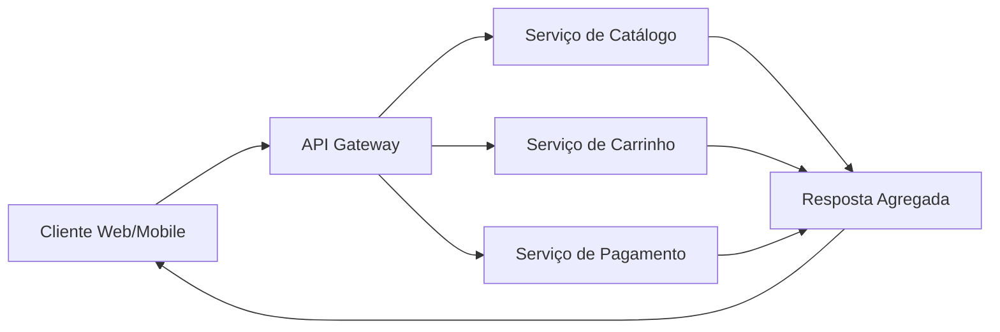
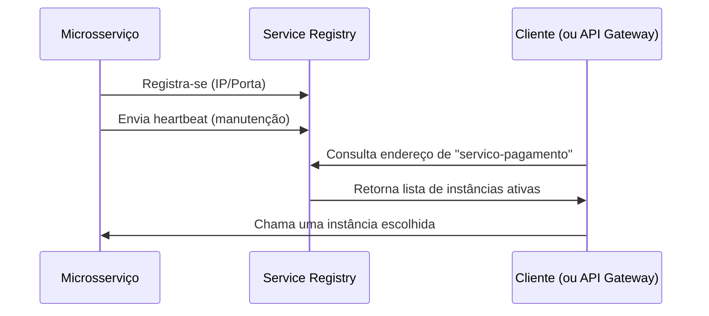
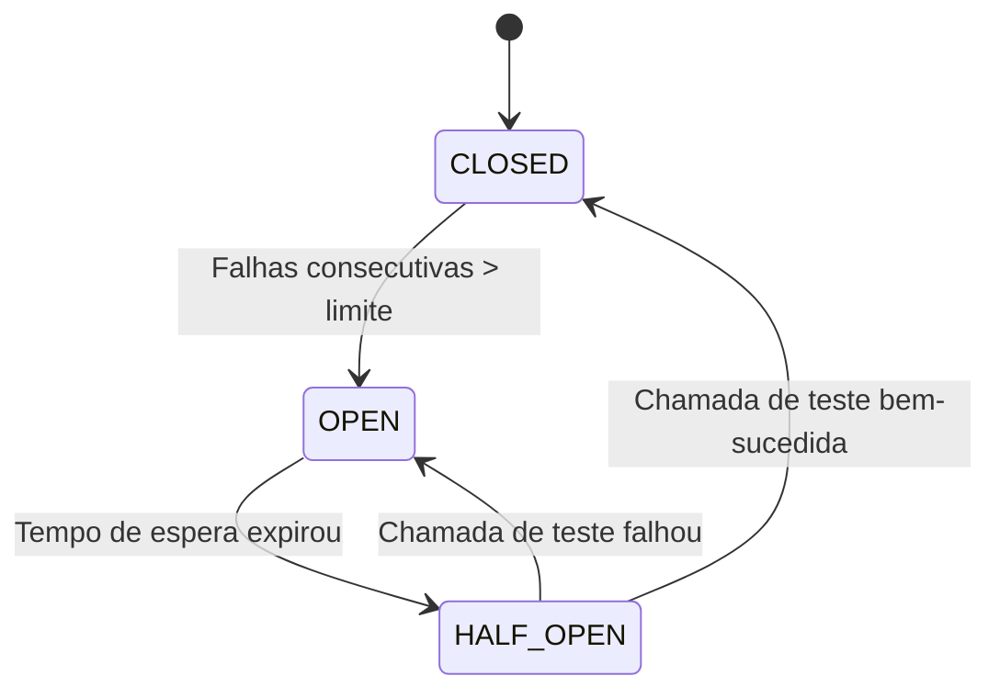
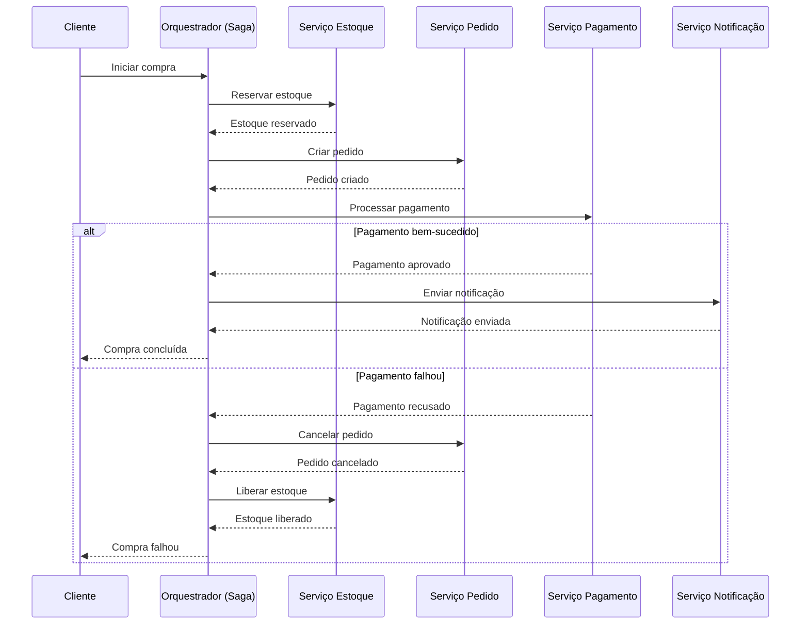

# Padrões Essenciais em Arquiteturas de Microsserviços

## 1. API Gateway

### Descrição:
O API Gateway é o único ponto de entrada para clientes externos (web, mobile, terceiros). Ele roteia requisições para os microsserviços apropriados, agregando funcionalidades como autenticação, rate limiting, caching e agregação de respostas.

### Vantagens:
- Abstrai a complexidade da arquitetura de microsserviços do cliente.
- Centraliza segurança, monitoramento e controle de tráfego.
- Permite combinar chamadas a múltiplos serviços em uma única requisição (agregação).

### Desvantagens:
- Pode se tornar um gargalo ou ponto único de falha se não for escalável.
- Requer alta disponibilidade e monitoramento contínuo.

### Exemplo de fluxo:

Cliente → [API Gateway] → (roteia para) → [Serviço de Catálogo] + [Serviço de Carrinho] → (resposta agregada) → Cliente

## 2. Service Discovery

### Descrição:
Em ambientes dinâmicos de microsserviços (ex: containers em Kubernetes), as instâncias dos serviços mudam de IP/porta constantemente. O Service Discovery permite que serviços descubram dinamicamente onde estão outras instâncias disponíveis.

### Dois modelos principais:
- Client-Side Discovery: O cliente (ou API Gateway) consulta um registro (ex: Consul, Eureka) para encontrar o endereço do serviço.
- Server-Side Discovery: Um balanceador de carga (ex: Envoy, NGINX) consulta o registro e roteia a requisição.

### Vantagens:
- Escalabilidade automática: novas instâncias são adicionadas sem configuração manual.
- Resiliência: se uma instância cair, ela é removida do registro automaticamente.

### Desvantagens:
- Adiciona complexidade de rede e dependência de um serviço de registro confiável.

## 3. Circuit Breaker

### Descrição:
Evita que uma falha em um microsserviço cause cascata de falhas em outros serviços. Quando um serviço externo começa a falhar repetidamente, o Circuit Breaker “abre” e interrompe temporariamente as chamadas, retornando uma resposta rápida (fallback) em vez de esperar timeout.

### Três estados:
- CLOSED: Chamadas normais.
- OPEN: Todas as chamadas falham imediatamente (fallback ativo).
- HALF_OPEN: Testa uma chamada para ver se o serviço voltou; se sim, fecha o circuito.

### Vantagens:
- Melhora a resiliência do sistema inteiro.
- Reduz carga em serviços já sobrecarregados.
- Permite recuperação automática.

### Exemplo: 
Se o serviço de pagamento falhar 5 vezes em 10s, o circuito abre por 30s — retornando “pagamento temporariamente indisponível”.

## 4. Padrão SAGA

### Descrição:
Gerencia transações distribuídas entre múltiplos microsserviços quando não é possível usar transações ACID (por exemplo, entre bancos de dados distintos). Uma Saga é uma sequência de transações locais, onde cada passo tem um compensatório (rollback) associado.

### Dois tipos:
- Orquestração: Um orquestrador (serviço central) coordena a ordem das ações e os compensatórios.
- Choreography: Cada serviço emite eventos; outros serviços reagem e executam suas próprias ações e compensações.

### Vantagens:
- Permite consistência eventual em sistemas distribuídos.
- Não bloqueia recursos por longos períodos.

### Desvantagens:
- Complexidade de implementação e rastreamento de estado.
- Dificuldade em garantir atomicidade.

### Exemplo: 
Compra de produto → reserva estoque → cria pedido → processa pagamento → envia notificação.
Se o pagamento falhar, executa: cancela pedido → libera estoque.

## Observações finais:

- API Gateway: É o “frontdoor” da arquitetura.
- Service Discovery: Garante que serviços encontrem uns aos outros dinamicamente.
- Circuit Breaker: Protege o sistema contra falhas em cadeia.
- SAGA: Resolve o problema de transações distribuídas sem banco de dados global.

Esses padrões são complementares e geralmente usados juntos em sistemas produtivos de microsserviços.