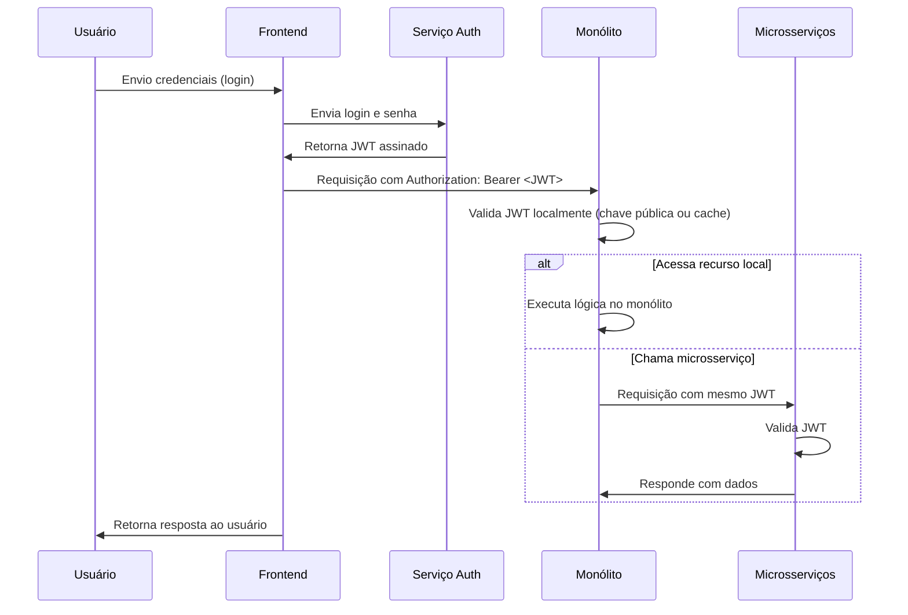
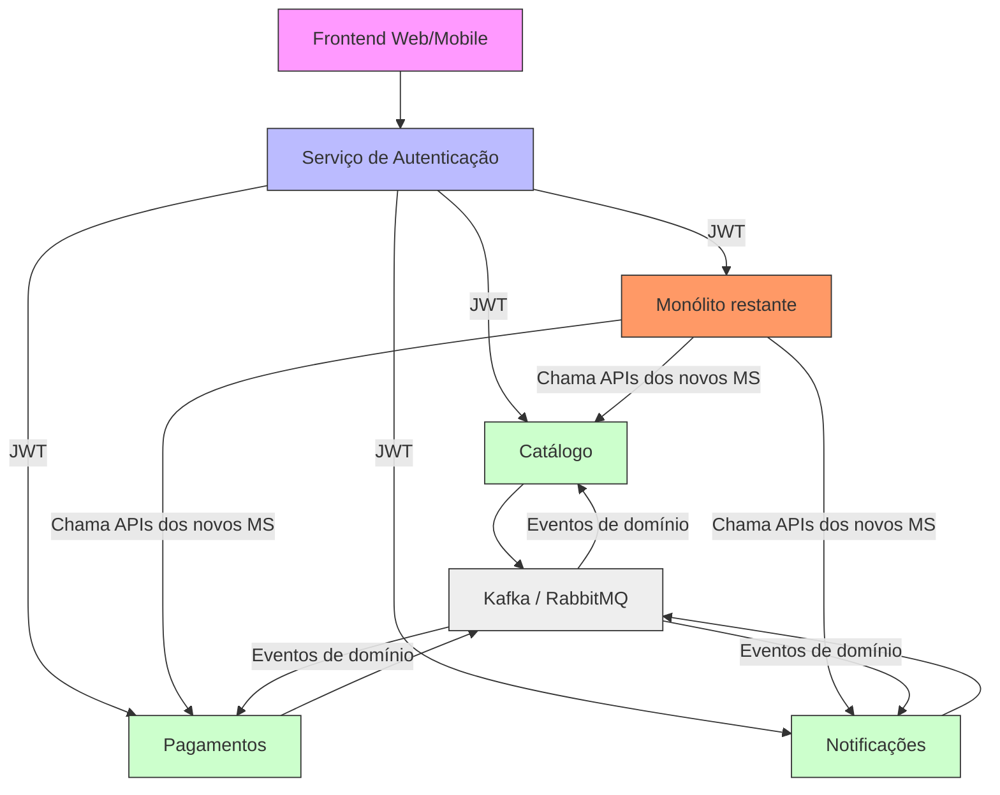

## Dicas para o professor:

- Discuta em sala após a entrega: compare as estratégias escolhidas pelos grupos.
- Destaque a importância do “Strangler Pattern” como a mais segura e realista.
- Explore o conceito de “bounded context” (DDD) ao definir os microsserviços.
- Lembre-se de enfatizar: não migre tudo de uma vez — migre o que traz valor rápido e baixo risco.

## Exemplo de resposta parcial (para guiar):
1. Microsserviços sugeridos:
- Serviço de Autenticação (separar lógica de usuário para segurança e escalabilidade)
- Serviço de Catálogo (alta frequência de leitura, pode ser replicado e cacheado)
- Serviço de Pagamentos (crítico, precisa de alta disponibilidade e compliance)
- Serviço de Notificações (assíncrono, pode usar filas)

2. Estratégia escolhida: Strangler Pattern — permite substituir gradualmente funcionalidades sem interromper o sistema legado.

3. Primeiro passo: Migrar o serviço de Autenticação. É isolado, tem poucas dependências externas e impacta todos os outros módulos — melhorar a segurança logo já traz valor. Métricas: tempo de login, taxas de erro, uso de tokens JWT.

4. Integração: Comunicação via REST/HTTPS com OAuth2. O monólito redireciona requisições de login para o novo serviço.

5. Riscos: 
- Fragmentação de dados: mitigar com eventos de domínio e eventual consistência.
- Complexidade operacional: mitigar com Kubernetes + Prometheus + Grafana desde o início.

# Gabarito Completo: Exercício – Planejando a Migração de uma Aplicação Monolítica para Microsserviços

## **Cenário Recapitulativo**
A empresa **E-ShopBR** opera um sistema monolítico em Java (Spring Boot) com as seguintes funcionalidades integradas:
- Gerenciamento de usuários  
- Catálogo de produtos  
- Carrinho de compras  
- Processamento de pedidos  
- Pagamentos  
- Notificações  

Problemas: lançamentos lentos, dificuldade de escalar componentes críticos, conflitos entre equipes, alta taxa de falhas por acoplamento rígido.

## **1. Identifique os 4 principais microsserviços que devem ser criados, justificando por que cada um deve ser separado.**

| Microsserviço | Justificativa |
|---------------|---------------|
| Serviço de Autenticação e Autorização (Auth) | É um componente transversal usado por todos os outros módulos. Separá-lo permite centralizar segurança (OAuth2, JWT), reutilização em outras aplicações, escalabilidade independente e integração com provedores externos (Google, Facebook). Além disso, reduz riscos de vazamento de credenciais no monólito. |
| Serviço de Catálogo de Produtos | Alta frequência de leitura, baixa escrita. Pode ser replicado em múltiplas instâncias, cacheado com Redis, e até distribuído geograficamente (CDN). A separação permite otimizações específicas de banco de dados (ex: Elasticsearch para busca) sem afetar outros módulos. |
| Serviço de Pagamentos | Requer alta disponibilidade, conformidade com PCI-DSS, integração com gateways externos (Mercado Pago, PayPal), e processamento assíncrono. É crítico e sensível — qualquer falha no monólito pode travar toda a venda. Separar permite SLAs independentes, monitoramento rigoroso e retry mechanisms robustos. |
| Serviço de Notificações | Envolve comunicação assíncrona (e-mail, SMS, push). Pode sofrer picos (ex: após compra) e depende de serviços externos com latência variável. Separar permite fila (RabbitMQ/Kafka), backoff, retries e fallbacks sem impactar a experiência do usuário na compra. |

> Observação: O carrinho e o processamento de pedidos poderiam ser combinados ou separados. Mas, por simplicidade e foco na primeira fase da migração, sugerimos priorizar os mais críticos e isoláveis.

## **2. Escolha uma estratégia de migração e explique sua escolha.**

### Estratégia escolhida: Strangler Pattern

#### Por quê?
O **Strangler Pattern** é a melhor abordagem porque:
- Permite substituir gradualmente partes do monólito sem interromper o serviço.
- Mantém o sistema funcionando durante toda a migração — essencial para uma loja online com receita contínua.
- Reduz risco operacional: se um novo microsserviço falhar, o monólito ainda responde à requisição original.
- Facilita a evolução incremental: cada nova funcionalidade migrada é testada em produção com tráfego real.
- Permite treinar a equipe aos poucos, adotar novas tecnologias e ferramentas (Docker, Kubernetes, observability) sem pressão.

#### Por que NÃO escolher as outras?
- Big Bang Migration: Risco extremo. Parada total do sistema, tempo de inatividade alto, possibilidade de falha catastrófica. Inviable para e-commerce.
- Feature Toggle + Gradual Refactoring: Boa para evolução interna, mas não resolve o problema de acoplamento arquitetural. Ainda mantém o monólito como núcleo.
- Parallel Run + Shadow Traffic: Útil para validação, mas exige duplicação completa de infraestrutura e é caro. Melhor como complemento ao Strangler, não como estratégia principal.

> Conclusão: O Strangler Pattern combina segurança, viabilidade e alinhamento com princípios ágeis e DevOps.

## **3. Descreva o primeiro passo prático da migração — qual serviço você migraria primeiro? Por quê? Quais métricas você monitoraria para validar o sucesso?**

### Primeiro passo: Migrar o Serviço de Autenticação (Auth)

#### Por quê?
- É o ponto de entrada de todas as requisições (login, tokens, permissões).
- Tem baixa complexidade de domínio (não envolve lógica de negócio como estoque ou frete).
- Alta vantagem estratégica: ao centralizar autenticação, elimina-se cópias de código, melhora segurança, facilita SSO futuro.
- Permite testar a nova arquitetura com o menor impacto possível: o restante do sistema continua funcionando normalmente, apenas chama o novo serviço via API.

#### Métricas de sucesso a monitorar:

| Métrica | Objetivo |
|--------|----------|
| Tempo médio de login | Deve diminuir ou manter-se estável (ex: de 800ms → 400ms) |
| Taxa de erro de autenticação | < 0,1% (monitorar falhas de token, expiração, credenciais inválidas) |
| Uso de JWT | Verificar se tokens estão sendo gerados e validados corretamente |
| Latência da API Auth | Monitorar p95 e p99 com Prometheus/Grafana |
| Número de chamadas ao monólito | Deve cair progressivamente até zero |
| Incidentes relacionados a sessões | Redução de logs de “sessão expirada” ou “usuário não autorizado” |

> Ferramentas recomendadas: Prometheus + Grafana (métricas), ELK Stack (logs), Jaeger (tracing).

## **4. Proposta de integração: Como os novos microsserviços se comunicariam com o monólito remanescente? Sugira um protocolo e mecanismo de autenticação/autorização.**

### Protocolo de comunicação:
- REST/HTTP com JSON (simples, amplamente suportado, fácil de debugar).
- Para futuras escalas: introduzir gRPC entre microsserviços, mas manter REST para comunicação com o monólito.

### Mecanismo de autenticação e autorização:
- OAuth2 com JWT:
  - O usuário loga no novo serviço de Autenticação.
  - O serviço emite um JWT assinado com chave privada (RS256).
  - O monólito passa a aceitar apenas requisições com JWT válido.
  - O monólito valida o token com o serviço Auth (via endpoint `/validate-token`) ou usando chave pública (se estiver em cache).
  - Cada microsserviço também valida o JWT localmente (sem chamada ao Auth em cada requisição — otimização com cache de chaves públicas).

### Fluxo simplificado:

> Benefícios: 
> - Segurança unificada  
> - Não há necessidade de reescrever todo o monólito para usar OAuth  
> - Permite rotação de chaves sem downtime

---

## **5. Riscos e mitigação: Liste 2 riscos principais da migração e como você os mitigaria.**

| Risco | Mitigação |
|-------|-----------|
| 1. Fragmentação de dados e inconsistência eventual (ex: usuário criado no Auth, mas não no monólito; carrinho vinculado a ID desatualizado) | - Implementar eventos de domínio (ex: `UserCreatedEvent`, `OrderPlacedEvent`) publicados via Kafka. - Usar Saga Pattern para transações distribuídas. - Criar um serviço de sincronização (ou job batch) para consolidar dados críticos até a completa migração. |
| 2. Complexidade operacional crescente e falta de observabilidade (muitos serviços, difícil rastrear erros, monitoramento fragmentado) | - Adotar DevOps maduro desde o início: CI/CD automatizado (GitHub Actions/Jenkins), IaC (Terraform), containerização (Docker), orquestração (Kubernetes). - Implementar observabilidade completa: Prometheus (métricas), Loki (logs), Jaeger (distributed tracing). - Criar dashboards de saúde para cada microsserviço e alertas automáticos (PagerDuty, Slack). |

---

## **6. Bônus: Como garantir que o time de desenvolvimento não fique "preso" no monólito durante a transição? Que práticas de DevOps e cultura você implementaria?**

### Práticas para evitar "preso no monólito":

| Prática | Impacto |
|--------|---------|
| Equipes autônomas por microsserviço | Cada squad tem propriedade total de um serviço (desde código até deploy e monitoramento). Isso cria responsabilidade e motivação. |
| Contratos de API bem definidos (OpenAPI/Swagger) | Tornam a interface entre monólito e microsserviços clara, permitindo que equipes trabalhem em paralelo sem bloqueios. |
| CI/CD para todos os serviços | Cada microsserviço tem seu próprio pipeline de teste e deploy. O monólito não é mais o único ponto de liberação. |
| Feature Flags para controle de lançamentos | Ativar novos comportamentos apenas para alguns usuários (canary releases) para minimizar riscos. |
| Culture of Ownership & Blameless Postmortems | Incentivar que devs cuidem do código que produzem. Erros viram aprendizado, não culpas. |
| Refatoração contínua com testes automatizados | Garantir que cada mudança no monólito seja coberta por testes unitários e de integração antes da migração. |
| Treinamento técnico contínuo | Workshops semanais sobre Docker, Kubernetes, gRPC, eventos, etc. Para elevar a capacitação coletiva. |

> Cultura-chave:  
> **“Você construiu, você entrega, você cuida.”**  
> Isso quebra o paradigma do “time de operações vs. time de desenvolvimento”.

## Conclusão Final (para apresentação em sala)

> A migração de um monólito para microsserviços não é uma tarefa técnica, mas uma transformação organizacional.  
>  
> A estratégia ideal é o Strangler Pattern, iniciando pelo serviço mais isolado e de maior valor — neste caso, o Autenticação.  
>  
> Com boas práticas de DevOps, observabilidade, contratos de API e cultura de propriedade, a E-ShopBR pode migrar com segurança, reduzir riscos e obter ganhos de agilidade, escalabilidade e inovação em meses, não anos.  
>  
> Lembre-se: migre por valor, não por moda. Microsserviços não são a solução — eles são o meio para resolver problemas reais de negócio.

## Anexo: Diagrama da Arquitetura (Mermaid)

> *Nota: Este diagrama deve ser renderizado em um visualizador Mermaid compatível (ex: Mermaid Live Editor, Obsidian, Typora).*

## Nota final para correção (rubrica sugerida):

| Critério | Pontuação Máx. | Observações |
|---------|----------------|-------------|
| Identificação correta dos microsserviços | 2,0 | Justificativas claras e alinhadas ao domínio |
| Escolha adequada da estratégia | 2,0 | Justificativa sólida contra alternativas |
| Primeiro passo prático e métricas | 2,0 | Realista, mensurável, relevante |
| Integração e autenticação | 1,5 | Protocolo e fluxo coerentes |
| Riscos e mitigação | 1,5 | Dois riscos relevantes com soluções práticas |
| Bônus (cultura e DevOps) | 1,0 | Ideias concretas e aplicáveis |
| **Total** | **10,0** | |
