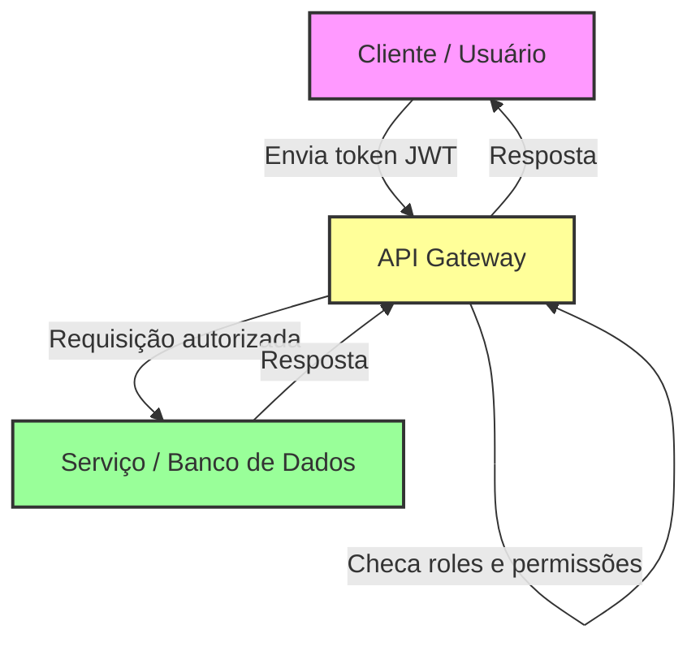

# 1. Análise de Código Inseguro

## Objetivo: 

Identificar falhas de segurança em um trecho de código Java simples.

## Descrição:

Trecho para os alunos encontrarem problemas:

```java
String query = "SELECT * FROM contas WHERE user='" + usuario + "' AND senha='" + senha + "'";
Statement stmt = conn.createStatement();
ResultSet rs = stmt.executeQuery(query);
```

## Perguntas:

- Quais problemas você identifica?
- Como corrigir?

## Respostas:

Problemas identificados:

- SQL Injection
    - O código concatena diretamente valores do usuário (usuario e senha) na query.
    - Um atacante pode digitar algo como ' OR '1'='1' -- para acessar contas sem senha.
- Exposição de dados sensíveis
    - Se a query falhar ou lançar exceção, pode vazar informações do banco.
    - Sem validação de entrada
- O código não valida ou sanitiza os inputs (usuario e senha).

### Como corrigir

- Usar PreparedStatement (ou equivalente seguro):

```java
String sql = "SELECT * FROM contas WHERE user=? AND senha=?";
PreparedStatement ps = conn.prepareStatement(sql);
ps.setString(1, usuario);
ps.setString(2, senha);
ResultSet rs = ps.executeQuery();
```

Evita SQL Injection, pois os valores são tratados como literais, não como código.

- Validação de entrada

Ex.: limitar tamanho de strings, caracteres permitidos, etc.

- Armazenamento seguro de senhas

    - Não guardar senhas em texto puro.
    - Usar hash seguro com salt (ex.: bcrypt, Argon2).


# 2. OWASP Top 10 Mapping

## Objetivo: 
Associar vulnerabilidades reais aos itens do OWASP Top 10.

## Descrição:

Lista de cenários:

- Entrada de usuário não sanitizada → ?
- Falta de autenticação multifator → ?
- Senhas salvas sem criptografia → ?
- Permissões excessivas no banco → ?

Os alunos devem acessar [OWASP Top 10](https://owasp.org/www-project-top-ten/) e relacionar cada cenário ao item correspondente no OWASP Top 10 e propor uma mitigação simples.

## Respostas:

Lista de cenários e respostas:

| Cenário                           | Item OWASP Top 10 (2021)                                         | Observação curta                                  |
| --------------------------------- | ---------------------------------------------------------------- | ------------------------------------------------- |
| Entrada de usuário não sanitizada | **A03:2021 – Injection / XSS**                                   | Pode causar SQL Injection ou Cross-Site Scripting |
| Falta de autenticação multifator  | **A07:2021 – Identification & Authentication Failures**          | Senha fraca ou sem MFA facilita acesso indevido   |
| Senhas salvas sem criptografia    | **A02:2021 – Cryptographic Failures**                            | Senhas em texto puro são facilmente roubáveis     |
| Permissões excessivas no banco    | **A05:2021 – Security Misconfiguration / Broken Access Control** | Usuários podem acessar dados ou funções indevidas |


# 3. Modelo Zero Trust

## Objetivo: 
Criar um mini diagrama de arquitetura com o conceito de Zero Trust.

## Descrição:

Divida os alunos em grupos.

Cada grupo desenha uma arquitetura simples de aplicação Java e inclui pontos de autenticação, autorização e verificação de identidade com Zero Trust.

Elementos que deve ser incluido no diagrama de arquitetura:

- Autenticação via token
    - JWT ou OAuth2
    - Cada requisição precisa apresentar credenciais válidas
- Autorização baseada em roles
    - Verificar se o usuário tem permissão para acessar recursos específicos
    - Ex.: roles como ADMIN, USER, GUEST
- Verificação contínua em cada requisição
    - Zero Trust: não confiar na rede interna
    - Sempre validar identidade e permissão, mesmo dentro da infraestrutura

Exemplo visual simples (para explicar em sala):

[ Cliente ] --Token--> [ API Gateway ] --Valida--> [ Serviço / Banco ]
                       |--Checa roles e permissões
                       |--Verifica token a cada requisição


Cada camada não confia em nada automaticamente → conceito Zero Trust.

## Respostas:



Explicação do diagrama

- Cliente: Usuário ou aplicação que faz requisição.
- API Gateway: Valida o token JWT, checa roles/permissões e decide se a requisição pode acessar o serviço.
- Serviço/Banco: Só recebe requisições autorizadas, sem confiar automaticamente na rede interna.
- Cada requisição é validada → conceito Zero Trust.

