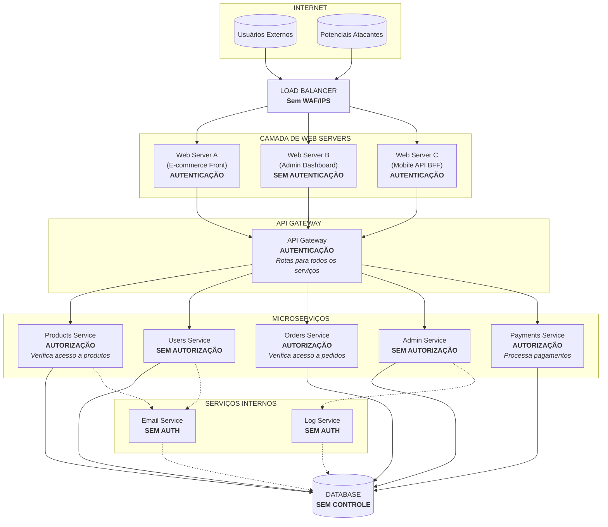
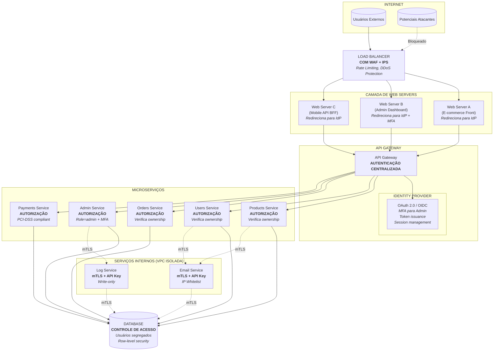

# Exercício 2: Análise de Arquitetura com Falhas de Autenticação/Autorização

## Objetivo

Analisar um diagrama de arquitetura de sistema e identificar onde os mecanismos de autenticação e autorização estão mal posicionados, propondo correções.

## Cenário

Uma startup de e-commerce está enfrentando problemas de segurança. O diagrama abaixo representa a arquitetura atual do sistema. Sua tarefa é identificar as falhas de posicionamento dos mecanismos de segurança e propor melhorias.

### Diagrama de Arquitetura Atual



## Perguntas - Exercício 2

**Pergunta 2.1:** Analise o Admin Dashboard (Web Server B). Qual é a principal vulnerabilidade de segurança neste componente? Que tipo de ataque poderia ser explorado?

**Pergunta 2.2:** Observe a posição da autenticação no fluxo. Existe redundância ou inconsistência no posicionamento dos mecanismos de autenticação? Explique o problema.

**Pergunta 2.3:** O Users Service não possui autorização. Quais dados sensíveis poderiam ser expostos? Descreva um cenário de violação de privacidade.

**Pergunta 2.4:** O Admin Service também não possui autorização. Qual é o risco associado? Como um atacante poderia escalar privilégios?

**Pergunta 2.5:** Analise os serviços internos (Email Service e Log Service). Por que a falta de autenticação/autorização entre serviços internos é problemática?

**Pergunta 2.6:** O banco de dados não possui controle de acesso granular. Quais são as implicações de segurança dessa configuração?

**Pergunta 2.7:** O Load Balancer não possui WAF (Web Application Firewall) ou IPS (Intrusion Prevention System). Que tipos de ataques não seriam bloqueados?

**Pergunta 2.8:** Proponha uma arquitetura corrigida, reposicionando os mecanismos de autenticação e autorização nos locais adequados. Descreva as mudanças necessárias.

## Passo a Passo para Análise

**Passo 1:** Mapeie todos os pontos de entrada
- Identifique todas as interfaces expostas à Internet
- Liste os serviços internos e suas comunicações

**Passo 2:** Analise a autenticação
- Verifique onde a identidade é validada
- Identifique componentes sem autenticação
- Avalie se há autenticação duplicada ou ausente

**Passo 3:** Analise a autorização
- Verifique onde as permissões são checadas
- Identifique componentes com acesso irrestrito
- Avalie o princípio do menor privilégio

**Passo 4:** Avalie a comunicação entre serviços
- Verifique se há autenticação service-to-service
- Analise o acesso ao banco de dados

**Passo 5:** Considere a defesa em profundidade
- Avalie se há múltiplas camadas de segurança
- Identifique pontos únicos de falha

**Passo 6:** Documente as falhas e propostas
- Liste cada vulnerabilidade encontrada
- Proponha correções específicas

## Tabela de Análise (Template para Preenchimento)

Use esta tabela para organizar suas descobertas:

| Componente | Autenticação Presente? | Autorização Presente? | Problema Identificado | Severidade (Alta/Média/Baixa) |
|------------|----------------------|----------------------|----------------------|------------------------------|
| Web Server A | | | | |
| Web Server B | | | | |
| Web Server C | | | | |
| API Gateway | | | | |
| Products Service | | | | |
| Users Service | | | | |
| Orders Service | | | | |
| Admin Service | | | | |
| Payments Service | | | | |
| Email Service | | | | |
| Log Service | | | | |
| Database | | | | |
| Load Balancer | N/A | N/A | | |

---

## Solução do Exercício 2

### Resposta 2.1 - Vulnerabilidade no Admin Dashboard

**Problema identificado:** O Admin Dashboard (Web Server B) não possui autenticação, permitindo acesso direto e irrestrito a funcionalidades administrativas.

**Tipo de ataque explorável:**

1. **Acesso não autorizado direto:** Qualquer usuário pode acessar o painel administrativo sem credenciais.

2. **Exposed Admin Interface:** A interface de administração está publicamente acessível pela Internet, sem nenhuma barreira de proteção.

**Cenário de ataque:**
```
1. Atacante descobre URL do admin: https://empresa.com/admin/
2. Atacante acessa diretamente (sem login)
3. Atacante tem acesso a:
   - Gestão de usuários
   - Configurações do sistema
   - Dados financeiros
   - Logs sensíveis
```

**Severidade:** CRÍTICA

---

### Resposta 2.2 - Redundância e Inconsistência na Autenticação

**Problemas identificados:**

1. **Autenticação duplicada e inconsistente:**
   - Web Server A: Realiza autenticação
   - Web Server C: Realiza autenticação
   - API Gateway: Realiza autenticação
   - Web Server B: Sem autenticação

2. **Over-authentication:** Alguns fluxos passam por múltiplas verificações de autenticação (Web Server A → API Gateway), criando:
   - Latência adicional
   - Complexidade de manutenção
   - Possíveis inconsistências nas políticas

3. **Under-authentication:** Web Server B não tem autenticação, quebrando o princípio de defesa em profundidade.

**Posicionamento correto:**
- A autenticação deve ser centralizada no API Gateway ou em um Identity Provider
- Frontends (Web Servers) não devem autenticar; devem apenas redirecionar para o provedor de identidade
- Todos os serviços devem confiar nos tokens/sessões emitidos pelo ponto centralizado

---

### Resposta 2.3 - Users Service sem Autorização

**Dados sensíveis expostos:**

1. **PII (Personally Identifiable Information):**
   - Nome completo
   - Email
   - Endereço
   - Telefone
   - CPF/RG

2. **Dados financeiros:**
   - Histórico de compras
   - Métodos de pagamento
   - Endereços de entrega

3. **Dados de conta:**
   - Hash de senha (se acessível)
   - Preferências
   - Histórico de sessões

**Cenário de violação de privacidade:**

```
1. Usuário regular (customer) faz login legítimo
2. Usuário modifica requisição para:
   GET /api/users/123  (outro usuário)
   
3. Users Service não verifica se o usuário tem permissão
   para acessar dados do usuário 123

4. Usuário recebe todos os dados pessoais de outro cliente

5. Escalação: Atacante enumera todos os IDs:
   for i in range(1, 100000):
       GET /api/users/{i}
       
6. Vazamento massivo de dados (data breach)
```

**Impacto:** Violação de LGPD/GDPR, multas potenciais, perda de confiança.

---

### Resposta 2.4 - Admin Service sem Autorização

**Risco associado:** Qualquer usuário autenticado pode acessar funcionalidades administrativas, caracterizando falha de controle de acesso (Broken Access Control - OWASP Top 10 #1).

**Cenário de escalação de privilégios:**

```
1. Atacante cria conta regular de cliente
2. Atacante descobre endpoints admin:
   GET /api/admin/users
   DELETE /api/admin/users/{id}
   POST /api/admin/config
   
3. Como está autenticado (token válido), a requisição passa
   pelo API Gateway

4. Admin Service não verifica se o usuário tem role "admin"

5. Atacante executa ações administrativas:
   - Promove própria conta para admin
   - Exclui contas de outros usuários
   - Modifica configurações do sistema
```

**Severidade:** CRÍTICA

---

### Resposta 2.5 - Serviços Internos sem Autenticação

**Por que é problemático:**

1. **Lateral movement:** Um atacante que compromete um serviço pode acessar outros serviços internos sem barreiras.

2. **Insider threats:** Funcionários mal-intencionados com acesso à rede interna podem abusar dos serviços.

3. **Supply chain attacks:** Terceiros com acesso à infraestrutura podem explorar serviços desprotegidos.

**Cenários de ataque:**

**Email Service:**
```
1. Atacante compromete um servidor web
2. Descobre endpoint interno do Email Service
3. Envia emails phishing em nome da empresa:
   POST http://email-service.internal/send
   {
     "to": "todos_clientes@lista.com",
     "subject": "Urgente: Atualize seus dados",
     "body": "Clique aqui para phishing..."
   }
```

**Log Service:**
```
1. Atacante acessa Log Service
2. Lê logs sensíveis contendo:
   - Tokens de sessão
   - Dados de cartão de crédito
   - Informações pessoais
   
3. Usa informações para outros ataques
```

**Solução:** Implementar autenticação service-to-service (mTLS, JWT, API Keys).

---

### Resposta 2.6 - Banco de Dados sem Controle de Acesso

**Implicações de segurança:**

1. **Privilégios excessivos:** Cada serviço tem acesso a todas as tabelas, violando o princípio do menor privilégio.

2. **Single point of compromise:** Se qualquer serviço for comprometido, o atacante tem acesso a todos os dados.

3. **Data exfiltration facilitada:** Não há barreiras para exportação massiva de dados.

4. **SQL Injection amplificado:** Uma vulnerabilidade em qualquer serviço afeta todos os dados.

**Cenário de ataque:**

```
1. Products Service tem vulnerabilidade SQL Injection
2. Como o DB não tem controle de acesso por serviço,
   a query maliciosa pode acessar:
   
   SELECT * FROM users        (não deveria ser acessível ao Products Service)
   SELECT * FROM payments     (não deveria ser acessível ao Products Service)
   SELECT * FROM admin_logs   (não deveria ser acessível ao Products Service)
   
3. Comprometimento total do banco de dados
```

**Correção:** Criar usuários de banco de dados separados para cada serviço com permissões mínimas:
- Products Service → Acesso apenas à tabela products
- Users Service → Acesso apenas à tabela users
- Orders Service → Acesso às tabelas orders e order_items

---

### Resposta 2.7 - Load Balancer sem WAF/IPS

**Ataques não bloqueados:**

1. **SQL Injection:** Tentativas de injeção SQL não são filtradas.

2. **XSS (Cross-Site Scripting):** Scripts maliciosos não são detectados.

3. **Path Traversal:** Tentativas de acessar arquivos do sistema (`../../etc/passwd`).

4. **Command Injection:** Comandos de sistema injetados em parâmetros.

5. **DDoS L7:** Ataques de aplicação não são mitigados.

6. **Brute Force:** Tentativas repetidas de login não são rate-limited.

7. **Bot Traffic:** Bots maliciosos não são identificados e bloqueados.

8. **API Abuse:** Uso indevido de APIs não é detectado.

**Exemplo de ataque que passaria:**

```http
POST /api/users HTTP/1.1
Host: empresa.com
Content-Type: application/json

{
  "name": "admin' OR '1'='1' --",
  "email": "attacker@evil.com"
}
```

Sem WAF, essa requisição SQL Injection chegará ao serviço de backend.

---

### Resposta 2.8 - Arquitetura Corrigida

**Diagrama de Arquitetura Segura:**



---

### Resumo das Correções

| Problema | Correção Aplicada |
|----------|-------------------|
| Load Balancer sem WAF | Adicionar WAF + IPS + Rate Limiting |
| Autenticação inconsistente nos frontends | Centralizar autenticação no Identity Provider |
| Web Server B sem autenticação | Redirecionar para IdP com MFA obrigatório para admin |
| API Gateway com autenticação duplicada | Manter como ponto único de validação de tokens |
| Users Service sem autorização | Implementar verificação de ownership |
| Admin Service sem autorização | Verificar role=admin + MFA + audit logging |
| Serviços internos sem auth | Implementar mTLS + API Keys + IP Whitelist |
| Banco de dados sem controle | Segregação de usuários + Row-level security |

---

### Princípios de Segurança Aplicados

1. **Defesa em Profundidade:** Múltiplas camadas de segurança (WAF → API Gateway → Service → Database)

2. **Princípio do Menor Privilégio:** Cada serviço e usuário tem apenas os acessos necessários

3. **Centralização de Autenticação:** Identity Provider único para consistência

4. **Autorização em Múltiplas Camadas:** API Gateway (coarse-grained) + Services (fine-grained)

5. **Zero Trust Interno:** Autenticação mesmo entre serviços internos

6. **Segregação de Responsabilidades:** Usuários de banco de dados separados por serviço

---

## Critérios de Avaliação

### Exercício 1 - Pontuação Sugerida

| Pergunta | Pontos | Critério |
|----------|--------|----------|
| 1.1 | 10 | Identificação correta do armazenamento e risco XSS |
| 1.2 | 10 | Análise correta da transmissão e flags de segurança |
| 1.3 | 10 | Compreensão de stateful vs stateless e revogação |
| 1.4 | 15 | Identificação de pelo menos 3 vulnerabilidades distintas |
| 1.5 | 15 | Descrição detalhada do cenário de ataque |
| 1.6 | 20 | Justificativa completa com múltiplos critérios |
| **Total** | **80** | |

### Exercício 2 - Pontuação Sugerida

| Pergunta | Pontos | Critério |
|----------|--------|----------|
| 2.1 | 10 | Identificação da vulnerabilidade crítica no Admin |
| 2.2 | 10 | Análise da inconsistência de autenticação |
| 2.3 | 10 | Cenário de violação de privacidade |
| 2.4 | 10 | Cenário de escalação de privilégios |
| 2.5 | 10 | Análise de service-to-service security |
| 2.6 | 10 | Implicações do DB sem controle |
| 2.7 | 10 | Ataques não bloqueados sem WAF |
| 2.8 | 20 | Arquitetura corrigida completa |
| **Total** | **90** | |

---

## Referências

1. OWASP Top 10 - 2021: https://owasp.org/Top10/
2. OWASP Authentication Cheat Sheet: https://cheatsheetseries.owasp.org/cheatsheets/Authentication_Cheat_Sheet.html
3. OWASP Session Management Cheat Sheet: https://cheatsheetseries.owasp.org/cheatsheets/Session_Management_Cheat_Sheet.html
4. JWT.io - Introduction to JSON Web Tokens: https://jwt.io/introduction
5. RFC 6749 - OAuth 2.0: https://tools.ietf.org/html/rfc6749
6. RFC 6750 - Bearer Token Usage: https://tools.ietf.org/html/rfc6750
