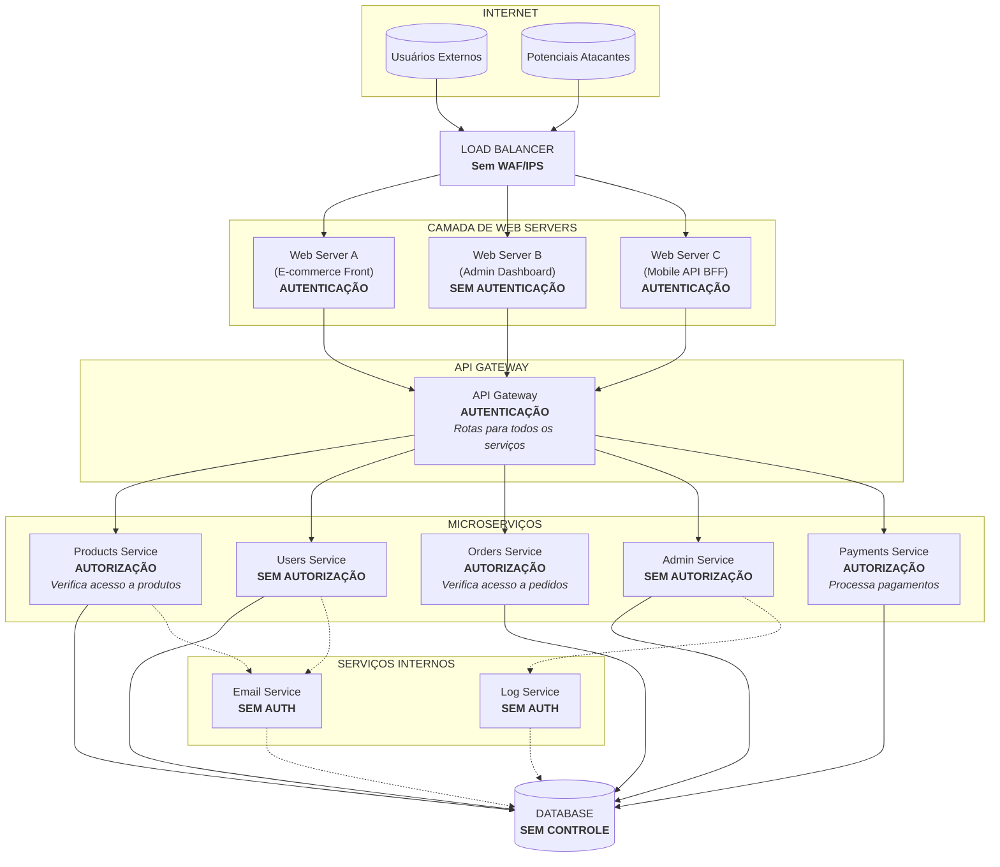

# Exercício 2: Análise de Arquitetura com Falhas de Autenticação/Autorização

## Objetivo

Analisar um diagrama de arquitetura de sistema e identificar onde os mecanismos de autenticação e autorização estão mal posicionados, propondo correções.

## Cenário

Uma startup de e-commerce está enfrentando problemas de segurança. O diagrama abaixo representa a arquitetura atual do sistema. Sua tarefa é identificar as falhas de posicionamento dos mecanismos de segurança e propor melhorias.

### Diagrama de Arquitetura Atual

## Perguntas - Exercício 2

**Pergunta 2.1:** Analise o Admin Dashboard (Web Server B). Qual é a principal vulnerabilidade de segurança neste componente? Que tipo de ataque poderia ser explorado?

**Pergunta 2.2:** Observe a posição da autenticação no fluxo. Existe redundância ou inconsistência no posicionamento dos mecanismos de autenticação? Explique o problema.

**Pergunta 2.3:** O Users Service não possui autorização. Quais dados sensíveis poderiam ser expostos? Descreva um cenário de violação de privacidade.

**Pergunta 2.4:** O Admin Service também não possui autorização. Qual é o risco associado? Como um atacante poderia escalar privilégios?

**Pergunta 2.5:** Analise os serviços internos (Email Service e Log Service). Por que a falta de autenticação/autorização entre serviços internos é problemática?

**Pergunta 2.6:** O banco de dados não possui controle de acesso granular. Quais são as implicações de segurança dessa configuração?

**Pergunta 2.7:** O Load Balancer não possui WAF (Web Application Firewall) ou IPS (Intrusion Prevention System). Que tipos de ataques não seriam bloqueados?

**Pergunta 2.8:** Proponha uma arquitetura corrigida, reposicionando os mecanismos de autenticação e autorização nos locais adequados. Descreva as mudanças necessárias.

## Passo a Passo para Análise

**Passo 1:** Mapeie todos os pontos de entrada
- Identifique todas as interfaces expostas à Internet
- Liste os serviços internos e suas comunicações

**Passo 2:** Analise a autenticação
- Verifique onde a identidade é validada
- Identifique componentes sem autenticação
- Avalie se há autenticação duplicada ou ausente

**Passo 3:** Analise a autorização
- Verifique onde as permissões são checadas
- Identifique componentes com acesso irrestrito
- Avalie o princípio do menor privilégio

**Passo 4:** Avalie a comunicação entre serviços
- Verifique se há autenticação service-to-service
- Analise o acesso ao banco de dados

**Passo 5:** Considere a defesa em profundidade
- Avalie se há múltiplas camadas de segurança
- Identifique pontos únicos de falha

**Passo 6:** Documente as falhas e propostas
- Liste cada vulnerabilidade encontrada
- Proponha correções específicas

## Tabela de Análise (Template para Preenchimento)

Use esta tabela para organizar suas descobertas:

| Componente | Autenticação Presente? | Autorização Presente? | Problema Identificado | Severidade (Alta/Média/Baixa) |
|------------|----------------------|----------------------|----------------------|------------------------------|
| Web Server A | | | | |
| Web Server B | | | | |
| Web Server C | | | | |
| API Gateway | | | | |
| Products Service | | | | |
| Users Service | | | | |
| Orders Service | | | | |
| Admin Service | | | | |
| Payments Service | | | | |
| Email Service | | | | |
| Log Service | | | | |
| Database | | | | |
| Load Balancer | N/A | N/A | | |
