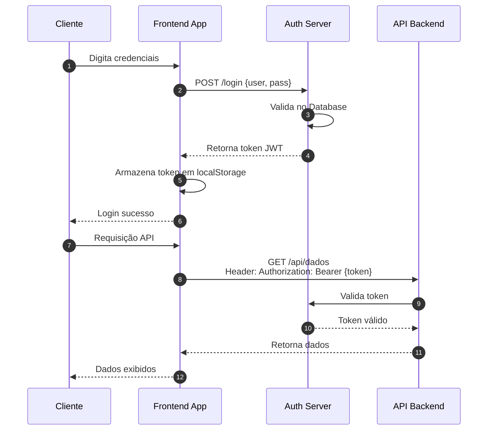
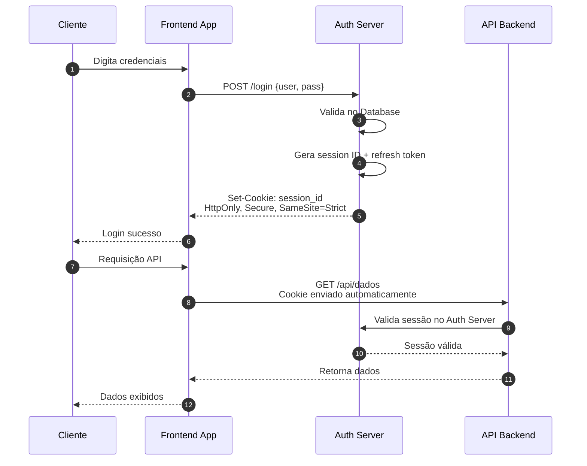

# Exercício 1: Comparação de Fluxos de Login

## Objetivo

Analisar dois fluxos de autenticação (Fluxo A e Fluxo B) e identificar as diferenças arquiteturais críticas que tornam um seguro e outro vulnerável a ataques.

## Cenário

Uma empresa de fintech está avaliando duas propostas de arquitetura para seu sistema de login. Sua tarefa é analisar ambos os fluxos e determinar qual é mais seguro, justificando sua resposta.

### Fluxo A - Diagrama de Sequência

### Fluxo B - Diagrama de Sequência

## Perguntas - Exercício 1

**Pergunta 1.1:** Observando os dois fluxos, identifique onde o token/sessão é armazenado no lado do cliente em cada caso. Qual das abordagens apresenta maior risco de exposição a ataques XSS? Justifique sua resposta.

**Pergunta 1.2:** Analise como o token/sessão é transmitido em cada fluxo. Qual fluxo está mais suscetível a ataques de interceptação (Man-in-the-Middle)? Explique o porquê.

**Pergunta 1.3:** Compare os mecanismos de validação nos fluxos. Qual abordagem oferece melhor controle para revogação de acesso? Por quê?

**Pergunta 1.4:** Identifique pelo menos 3 vulnerabilidades de segurança presentes no Fluxo A que não existem no Fluxo B.

**Pergunta 1.5:** Se um atacante conseguir injetar código JavaScript malicioso na página do frontend, qual seria o impacto em cada fluxo? Descreva o cenário de ataque.

**Pergunta 1.6:** Qual fluxo você recomendaria para uma aplicação bancária? Justifique sua resposta com base em pelo menos 3 critérios de segurança.

## Passo a Passo para Análise

Para realizar este exercício de forma sistemática, siga os seguintes passos:

**Passo 1:** Identifique o mecanismo de armazenamento
- Analise onde as credenciais de sessão são guardadas no navegador
- Considere a acessibilidade desse armazenamento via JavaScript

**Passo 2:** Avalie o método de transmissão
- Observe como o token/cookie é enviado em cada requisição
- Verifique se há proteções automáticas do navegador

**Passo 3:** Analise o ciclo de vida do token/sessão
- Determine se a validação é stateless ou stateful
- Considere a possibilidade de revogação imediata

**Passo 4:** Considere vetores de ataque
- XSS (Cross-Site Scripting)
- CSRF (Cross-Site Request Forgery)
- MITM (Man-in-the-Middle)
- Token theft (roubo de token)

**Passo 5:** Documente suas conclusões
- Liste as vulnerabilidades encontradas
- Compare os riscos de cada abordagem