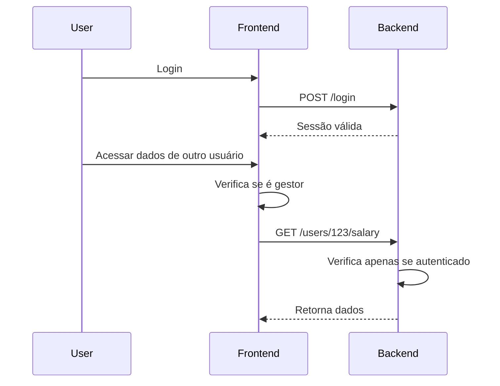
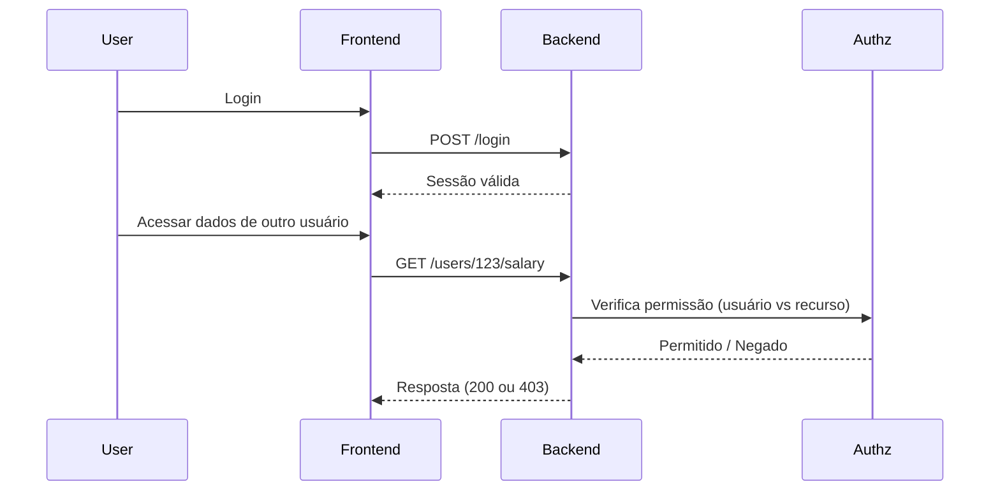
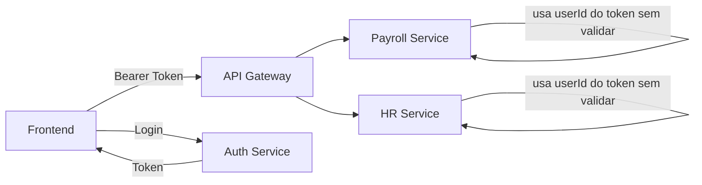
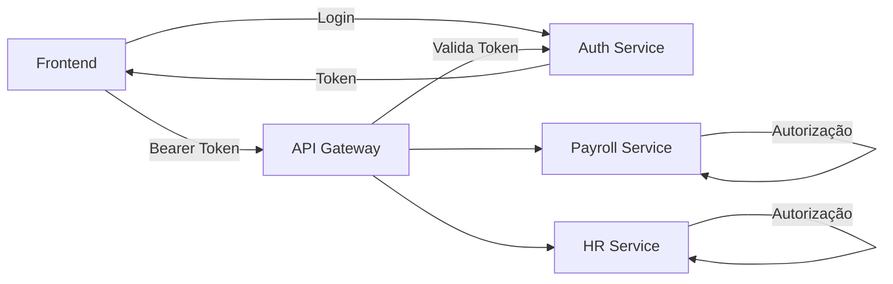
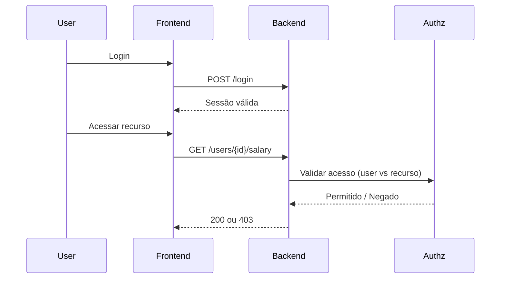
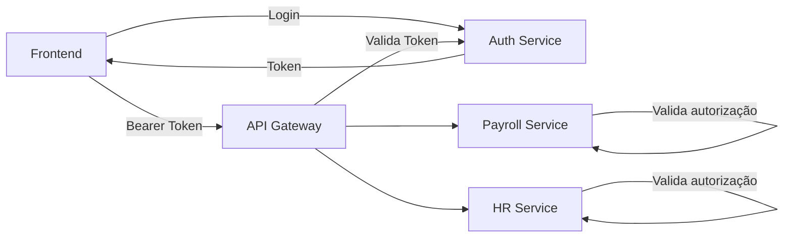

# Exercícios de Segurança – Autenticação e Autorização

# Exercício 1 – Análise de Fluxos de Autorização

## Objetivo
Identificar falhas de autorização em diferentes fluxos de sistema.

## Fluxo A

## Fluxo B

## Tarefas

1. Identifique onde ocorre autenticação em ambos os fluxos  
2. Identifique onde ocorre autorização em ambos os fluxos  
3. Explique por que o Fluxo A é inseguro  
4. Descreva um cenário de exploração possível  
5. Proponha correções arquiteturais  

# Exercício 2 – Análise de Arquitetura

## Objetivo
Identificar problemas de autenticação e autorização em arquitetura distribuída.

## Arquitetura Atual

## Arquitetura Proposta (referência para análise)

## Tarefas

1. Identifique onde ocorre autenticação na arquitetura atual  
2. Identifique onde a autenticação deveria ocorrer  
3. Identifique falhas de autorização  
4. Explique o risco de confiar em `userId` vindo do cliente  
5. Liste possíveis ataques  
6. Proponha melhorias  

---

# Soluções

## Solução – Exercício 1

### Problemas identificados

- Autorização realizada no frontend  
- Backend não valida acesso ao recurso  
- Usuário autenticado pode acessar qualquer recurso  

### Fluxo corrigido

### Correções

- Mover autorização para o backend  
- Validar relação usuário → recurso  
- Não confiar em validação do frontend  

## Solução – Exercício 2

### Problemas identificados

- Gateway não valida autenticação  
- Serviços confiam em parâmetros do cliente  
- Ausência de controle de autorização  
- Falha de definição de trust boundary  

### Arquitetura corrigida

### Correções

- Centralizar autenticação no gateway  
- Validar token antes de acessar serviços  
- Implementar autorização nos serviços  
- Remover confiança em dados enviados pelo cliente  
